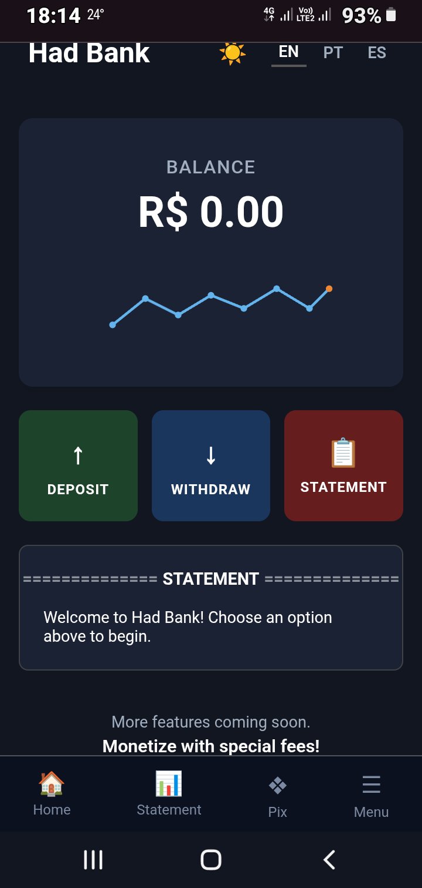
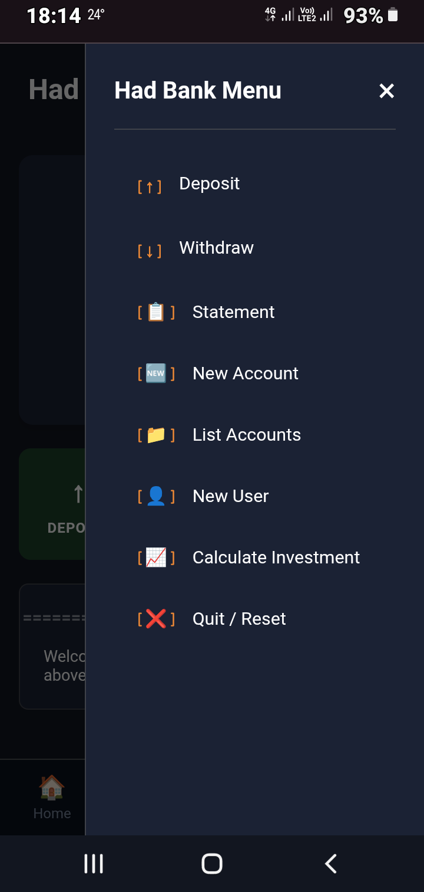

# Optimizing the Banking System with Python Functions

Project developed as part of the "Potência Tech" Bootcamp, powered by iFood | Data Science, under the guidance of expert [Guilherme Carvalho](https://github.com/guicarvalho "Guilherme Carvalho").

## Backend

In this challenge, you will have the opportunity to optimize the previously developed banking system by using Python functions. The goal is to improve the system's structure and efficiency by implementing deposit, withdrawal, and account statement operations as specific functions. You will be able to refactor the existing code, breaking it down into reusable functions, which will make the system easier to maintain and understand as a whole. Get ready to apply advanced programming concepts and demonstrate your ability to create more elegant and efficient solutions using Python.

## Frontend

A robust, semantic, and highly accessible banking front-end interface designed for **Had Bank**. This application acts as a comprehensive web prototype that mirrors the core execution logic of the Python object-oriented backend system. It features an integrated sliding modal menu to easily manage all bank actions across desktops, tablets, and mobile devices.

## Features

- **Multi-Account Sliding Menu:** A dynamic drawer panel triggered by the menu hamburger icon, allowing the user to call all administrative backend commands: `Deposit`, `Withdraw`, `Statement`, `New Account`, `List Accounts`, `New User`, `Calculate Investment`, and `Quit/Reset`.
- **Responsive Viewport Design:** Flexible layout built with CSS Grid and Flexbox, fully optimized to adapt seamlessly to compact smartphones, tablets, and full widescreen monitor configurations.
- **Dynamic Theme Architecture:** Native CSS variables providing an elegant Dark Mode (default state) alongside an alternative Light Mode, utilizing accessible sun and moon icon indicators.
- **Multilingual Support (i18n):** Client-side translation system matching English (EN-US - default language), Portuguese (PT-BR), and Spanish (ES-ES) preferences dynamically.
- **Interactive Terminal Ledger:** A stylized console section simulating the Python terminal view to report real-time transaction updates, account linkages, and error messages.

## Tech Stack

- **HTML5:** Highly semantic markup layer enforcing strict screen reader tags, interactive button controls, and structural landmarks.
- **CSS3:** Native styling utilizing custom transition hooks, dynamic theme variables mapping, and responsive media query breaking points.
- **JavaScript (ES6+):** In-memory application logic state engine controlling active translation dictionaries, database simulation arrays, and interactive UI state transitions.

## Future Improvements

- Integrate asynchronous `fetch` or `axios` API calls to bind this front-end interface to a Python web framework (e.g., FastAPI or Flask) running the `main.py` script.
- Add local storage persistence (`localStorage`) to preserve the registered users, accounts, and dark/light configuration after browser refreshes.
- Build strict format masks for Brazilian CPF strings and Date fields.

## Integration Architecture

To establish an end-to-end full-stack network channel with the accompanying `main.py` core engine, you can map the event listener handlers inside `script.js` to execute background HTTP network requests:

```javascript
// Integration boilerplate example:
fetch("http://127.0.0", {
  method: "POST",
  body: JSON.stringify({ amount: enteredValue })
})
```

|  |  |

[LICENSE](./LICENSE)
